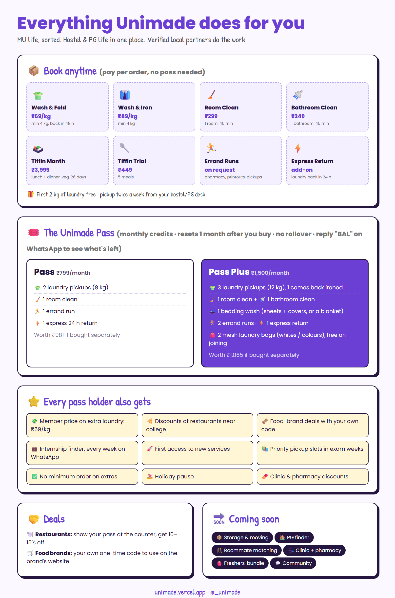
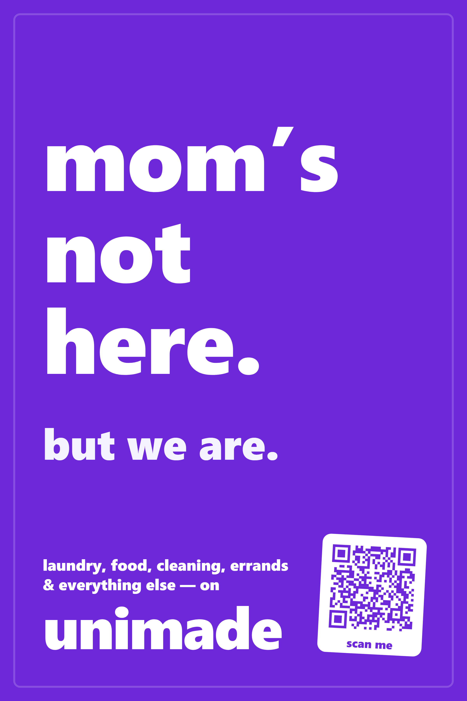
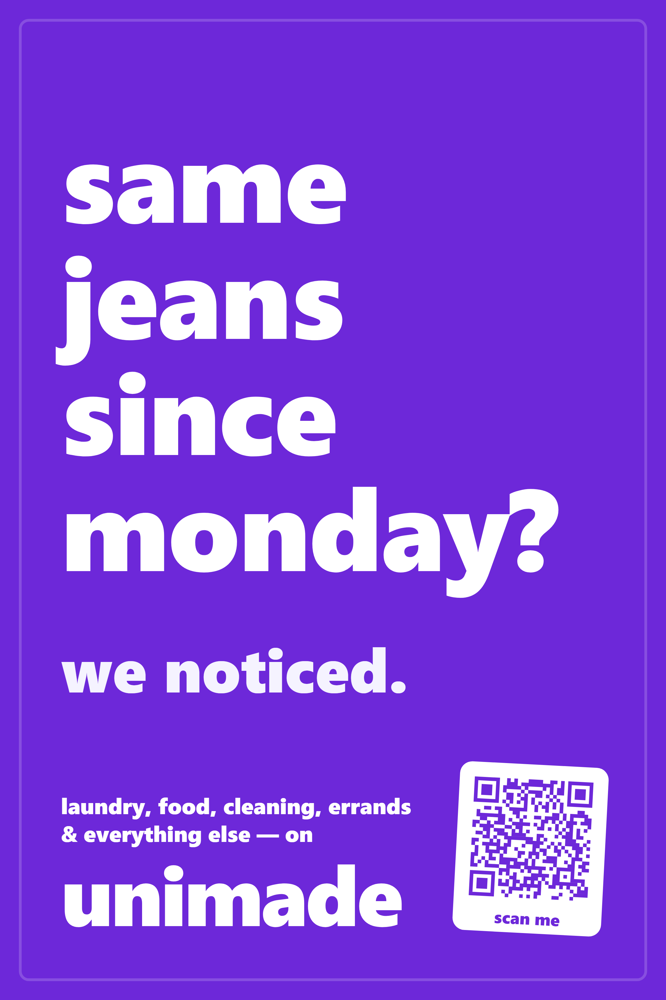

# Unimade

**A student-life platform for hostel and PG students, starting at Masters' Union, Gurugram.**
Students book everyday services in one place, verified local partners do the work, and Unimade keeps a cut. It is **not a laundry business**; laundry is just the first service.

Website: https://unimade.vercel.app · Instagram: [@_unimade](https://instagram.com/_unimade)

> Student project for the Masters' Union course "Scaling a D2C Business". All prices and forecasts are planning assumptions. There are no paying customers or vendor quotes yet.



## What students get

**Pay per order**

| Service | Price |
|---|---|
| Wash & fold | ₹69/kg (min 4 kg) |
| Wash & iron | ₹89/kg (min 4 kg) |
| Room clean | ₹299 |
| Bathroom clean | ₹249 |
| Tiffin month | ₹3,999 |
| Tiffin trial (5 meals) | ₹449 |
| Errand runs | price not set yet |
| Express 24-hour laundry return | add-on, price not set yet |

**The Pass** (credits reset one month after purchase, no rollover)

| | Pass ₹799/month | Pass Plus ₹1,500/month |
|---|---|---|
| Laundry | 2 pickups (8 kg) | 3 pickups (12 kg), one ironed |
| Room clean | 1 | 1 |
| Bathroom clean | none | 1 |
| Bedding wash | none | 1 |
| Errand runs | 1 | 2 |
| Express return | 1 | 1 |
| Mesh laundry bags | none | 2, once on joining |

Both tiers also get ₹59/kg on extra laundry, restaurant discounts, food-brand deals, an internship finder, first access to new services, priority slots in exam weeks, no minimum on extras, holiday pause, and clinic and pharmacy discounts.

**Coming later:** storage and moving, PG finder, roommate matching, clinic and pharmacy, freshers' bundle, community.

## How it makes money
1. The difference between what the student pays and what the partner gets (about 28% on services).
2. The monthly Pass.
3. Later: brand campaigns, featured listings, and PG placement fees paid by PG owners.

## Read more
| File or folder | What it is |
|---|---|
| [UNIMADE_WHAT_WE_DO.md](UNIMADE_WHAT_WE_DO.md) | Every product, perk, deal and rule (**current**) |
| [UNIMADE_MASTER_FACTS.md](UNIMADE_MASTER_FACTS.md) | Every number and plan version |
| [UNIMADE_GLOSSARY.md](UNIMADE_GLOSSARY.md) | Business terms in plain words |
| [START_HERE.md](START_HERE.md) | Setup: run the site, rebuild the PDFs |
| [01-website-source](01-website-source) | Website code and doodle images |
| [02-business-plans](02-business-plans) | v1 (superseded) and v2 plans, with models |
| [03-checkpoint3-media-plan](03-checkpoint3-media-plan) | Submitted CP3 media plan and page images |
| [04-newsletter](04-newsletter) | Welcome newsletter |
| [05-marketing-posters-ATL](05-marketing-posters-ATL) | Posters, planning sheet, QR code |
| [06-course-material](06-course-material) | Session slides, notes, templates, CP4 brief |
| [07-misc](07-misc) | Old home page, retention snapshot, site screenshots |
| [08-overview-image](08-overview-image) | The services image and its source |

Older documents, including CP3, the newsletter and the v1/v2 plans, mention things that have since been dropped, such as the ₹499 Laundry Pass and the Laundry Day Kit. `UNIMADE_WHAT_WE_DO.md` is current.

## Clone it
This repo is private, so the owner must first add you under Settings → Collaborators. Install [Git](https://git-scm.com), then:
```
git clone https://github.com/avinboi/unimade-everything.git
cd unimade-everything
```
Sign in to GitHub when asked. To run the website (needs Node.js 20+):
```
cd 01-website-source
npm install
npm run dev
```
The live site deploys from a separate repo, `avinboi/unimade`. Pushing here does not change the website.

## Posters



## Team
Avin Dev, Danni Khanna, Pradnya Oberoi, Zayra Siddiqui, Khushi Asija
